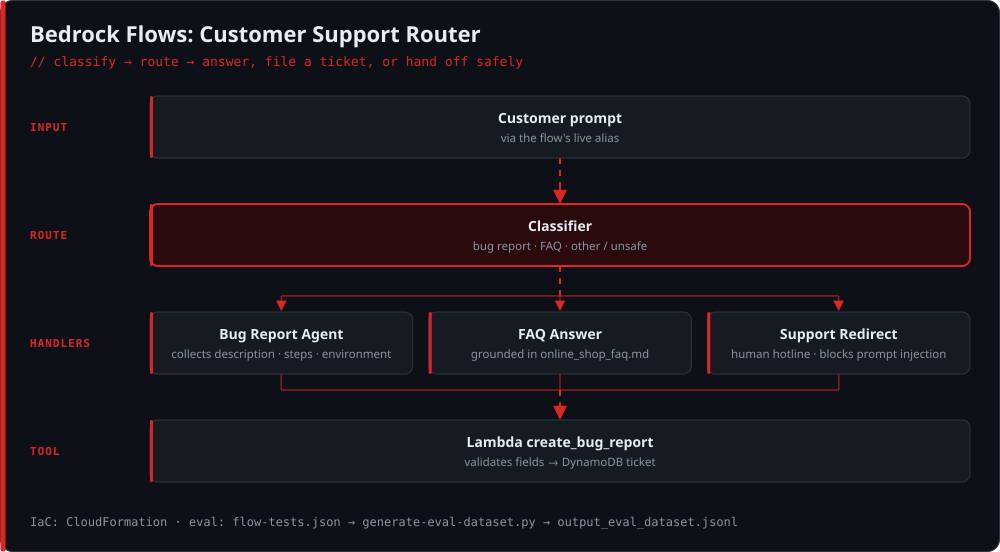
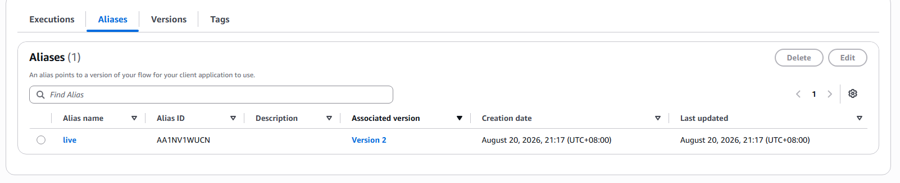

# 🔁 Amazon Bedrock Flows: Customer Support Router

**A GenAI customer support flow on Amazon Bedrock Flows. It classifies each request, answers FAQs from a knowledge source, files bug reports through a Lambda tool into DynamoDB, and safely redirects everything else to a human.**


---

## 🧭 How it works

<p align="center"></p>

| Route | What happens |
|---|---|
| **🐞 Bug report** | The agent collects `description`, `stepsToReproduce`, and `environment`, then calls the Lambda tool, which validates the fields and writes a ticket to DynamoDB |
| **❓ Platform FAQ** | Answers grounded in [`online_shop_faq.md`](online_shop_faq.md) |
| **↪️ Other / unsafe** | Redirects politely to human support, and **refuses prompt-injection attempts** such as *"ignore all previous instructions…"* |

The flow is published with a versioned **`live` alias**, so clients always call a stable endpoint.

## 📁 Repository

| File | Purpose |
|---|---|
| [`cloudformation-tool.yaml`](cloudformation-tool.yaml) | IaC for the bug-report tool: DynamoDB table, Lambda, least-privilege IAM role |
| [`cloudformation-testing.yaml`](cloudformation-testing.yaml) | Testing resources stack |
| [`create_bug_report.py`](create_bug_report.py) | Lambda handler for the Bedrock action-group tool with input validation |
| [`flow-tests.json`](flow-tests.json) | Test cases: bug report, FAQ, human hand-off, edge cases |
| [`generate-eval-dataset.py`](generate-eval-dataset.py) | Invokes the flow alias for every test and writes an evaluation dataset |
| [`output_eval_dataset.jsonl`](output_eval_dataset.jsonl) | Generated prompt / expected / actual dataset for model evaluation |

## 🧪 Evaluate the flow

```bash
pip install -r requirements.txt
python generate-eval-dataset.py   --tests-json flow-tests.json   --flow-id <FLOW_ID>   --flow-alias-id <ALIAS_ID>   --out-jsonl output_eval_dataset.jsonl
```

## 📸 Screenshots

| Published `live` alias | Prompt-injection defense |
|---|---|
|  |  |

---

<sub>Built by <a href="https://github.com/n0zzzy">Russel Carlo</a>.</sub>
